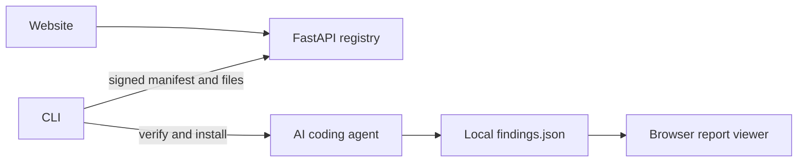

# VibePro

VibePro adds a structured security-review method to AI coding agents. It distributes a signed audit engine, verifies every downloaded file, and lets you review findings locally in your browser.

**You can present the complete project locally. Deployment and npm publishing are not required.**

## Run it for your presentation

Prerequisites: Node.js 22 or later recommended (18 minimum), npm 8 or later, and Python 3.12 or later for the API. All local setup and run commands use npm; no virtual-environment activation or manual pip commands are needed.

From the project folder, install dependencies once:

```powershell
npm install
```

Start the website and API:

```powershell
npm start
```

`npm install` installs the CLI workspace and automatically creates an ignored `.venv/` with the backend dependencies. `npm start` starts the website and API, reuses or creates an ignored local DEV signing key, and synchronizes its public key into the CLI and website.

Open these URLs, or use `npm start -- --open` to open both automatically:

- Website: <http://127.0.0.1:8011/>
- Sample report: <http://127.0.0.1:8011/report.html?sample=1>

Keep the server terminal open. Ctrl+C stops a server started by the launcher. If VibePro is already running on that port, the launcher verifies and reuses it without stopping it. The local SQLite database and key survive restarts.

For another port, use `npm start -- --port 8012` and add `--api http://127.0.0.1:8012` to the CLI commands below. If installation was interrupted or lifecycle scripts were disabled, run `npm run setup` to finish backend setup.

### Demonstrate the CLI

Open a second terminal in this project folder:

```powershell
npx vibepro-cli install --agent codex
npx vibepro-cli verify --agent codex
npx vibepro-cli doctor
```

Choose `claude`, `cursor`, `antigravity`, or `gemini` instead of `codex` if needed. `--dry-run` previews the destination; `--project` installs in the current repository rather than the user's home directory.

The website and copy buttons use `npx vibepro-cli`. After `npm install` in this checkout, npx resolves the local CLI workspace; it uses the local API on port 8011 when no API is configured. From a different machine without the checkout, that short command needs your CLI published to npm. A GitHub Release package is another distribution option; see [PUBLISH.md](PUBLISH.md#distribute-through-github-without-publishing-to-npm).

### Show a report

Use the website's sample report, drop a `findings.json` file into the viewer, or run:

```powershell
npm run report
```

The sample is illustrative, not a real audit of VibePro. The CLI validates the schema and opens its own loopback report server; keep that terminal open until finished, then press Ctrl+C. Report contents are never uploaded.

### Run an actual audit

VibePro's backend distributes the audit method; the AI coding agent performs the code review. Install VibePro for that agent, open the project you want reviewed, and ask it to **audit this project**. The agent needs its usual account, model access, and tools. It writes audit outputs under `~/security-audit-skill/<repo-name>/run-<N>/`.

From the audited project, run `npm --prefix /path/to/VibePro run cli -- report` to find its latest output, or run `npm run cli -- report /path/to/findings.json` from this checkout. You can also open the file in the website viewer.

Install dependencies before class. The website, API, CLI verification, and sample report work locally without an external service; the AI agent may still need internet access for its normal model service.

## What is included

| Folder | Purpose |
| --- | --- |
| `backend/` | FastAPI registry, Ed25519 signing, anonymous event counts, and static-site hosting |
| `web/` | Landing page and private report viewer; no frontend build step or CDN dependency |
| `cli/` | Installer, updater, integrity checks, diagnostics, and bundled report viewer |
| `engine/vibepro-audit/` | Editable upstream audit-method source with its license and provenance |
| `engine/1.0.0/` | Versioned release served by the API; intentionally separate from source |
| `scripts/` | Local launcher, end-to-end checks, and browser review tools |
| `docs/screenshots/product/` | Screenshots of the final website and report viewer |



## CLI commands

Use `npx vibepro-cli <command>` from the installed source checkout, or after publishing the CLI:

```text
install --agent <name> [--project] [--dry-run] [--no-telemetry]
update --agent <name> [--project] [--no-telemetry]
verify --agent <name> [--project]
doctor
report [file-or-directory] [--no-open]
uninstall --agent <name> [--project] [--no-telemetry]
list [--project]
about
```

`report` accepts a file, a directory containing `findings.json`, or no path to find the newest run for the current project. `uninstall` and report viewing do not require a running backend.

Use `--api <URL>` or `VIBEPRO_API` to select a different API. The local loopback default applies only to the source checkout; distributed packages use their configured production origin. `npm run cli -- <command>` remains available as a local convenience.

To invoke the Node CLI directly instead of the wrapper:

```powershell
$env:VIBEPRO_API = 'http://127.0.0.1:8011'
node cli/bin/vibepro.js install --agent codex
```

On macOS/Linux, use `export VIBEPRO_API=http://127.0.0.1:8011` when invoking the CLI directly. The npm launcher detects the Python executable automatically on every supported platform.

### npm commands

| Command | Purpose |
| --- | --- |
| `npm install` | Install CLI and backend dependencies |
| `npm start` | Start or reuse the local website and API |
| `npm start -- --open` | Also open the website and sample report |
| `npm run dev` | Same local server, for development |
| `npm run cli -- <command>` | Run the CLI against the local API |
| `npm run report` | Open the included sample findings |
| `npm run setup` | Repair or refresh backend dependencies |

The root package is private and is never published. The distributable `vibepro-cli` package stays separate and has no Python dependency or install lifecycle scripts; it connects to the deployed API.

## Verification and privacy

- The CLI verifies an Ed25519 signature before trusting a manifest, then checks every file's SHA-256 and size before installation.
- Failed installs restore the prior installation. Manifest paths are constrained to the target directory; symlink escapes are rejected.
- Production API traffic requires HTTPS. Plain HTTP is permitted only for loopback development.
- `verify` detects modified or missing installed files. Reinstall to restore verified release bytes.
- The CLI has no install/postinstall lifecycle scripts.
- Report files stay on the device. The CLI viewer binds only to loopback.
- Optional telemetry stores event type, agent, engine version, OS, and timestamp, not project contents or identities. Use `--no-telemetry` or `VIBEPRO_TELEMETRY=0` to opt out.
- `backend/keys/`, databases, logs, dependencies, and caches are ignored. Never upload the private key with the project.

## API

```text
GET  /health
GET  /api/v1/versions
GET  /api/v1/manifest?version=latest
GET  /api/v1/manifest/signed?version=latest
GET  /api/v1/versions/{version}/files/{path}
GET  /api/v1/files/{path}
GET  /api/v1/stats
POST /api/v1/events
```

## Run the checks

```powershell
python -m pip install -r backend/requirements-dev.txt
python -m pytest backend/tests -q
npm test --workspace vibepro-cli
python scripts/e2e.py
```

The end-to-end check uses a temporary home, disposable key, temporary server, and isolated in-memory database. It does not modify your installed agent or the presentation server.

Browser checks require the optional development tools and the local API:

```powershell
npm ci --prefix tools
npm exec --prefix tools -- playwright install chromium
node scripts/check-site.cjs
node scripts/review-site.cjs
```

GitHub Actions runs backend, CLI, package-tarball, and end-to-end checks on Windows, macOS, and Ubuntu. The upstream validator tests run on Ubuntu because they need POSIX file flags. A separate CI job builds and checks Docker. A local Docker build requires Docker Desktop's engine to be running.

## Deploy later

Keep using the local setup until after your presentation. Then:

1. Follow [DEPLOY.md](DEPLOY.md) to create a separate production signing key and deploy the API plus website.
2. Set the actual deployed HTTPS origin in `cli/lib/config.js`; the source checkout intentionally has no assumed public backend URL.
3. Verify the deployed site and manifest, then follow [PUBLISH.md](PUBLISH.md) to publish the CLI if you want public `npx` installation.

Vercel can host the FastAPI API and website, with deployment configuration and a persistent hosted database for stats; see [the Vercel notes](DEPLOY.md#can-this-run-on-vercel). The CLI can also be distributed as a GitHub Release tarball without npm publication; the exact short command `npx vibepro-cli` uses npm's registry outside this installed checkout.

## License and credit

VibePro is MIT licensed. Its audit methodology comes from [Cloudflare's security-audit-skill](https://github.com/cloudflare/security-audit-skill), also MIT licensed. See [LICENSE](LICENSE), [NOTICE](NOTICE), and `engine/vibepro-audit/UPSTREAM.md` for provenance.
