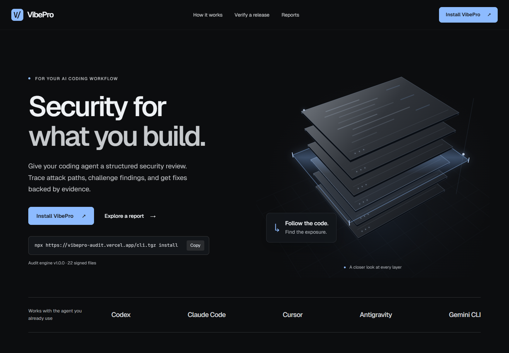

<div align="center">
  
  <h1>VibePro</h1>
  <p><strong>Security for what you build.</strong></p>
  <p>A structured security review for the AI coding agent you already use.</p>
  <p>
    <a href="https://vibepro-audit.vercel.app/">Website</a> ·
    <a href="https://vibepro-audit.vercel.app/report.html?sample=1">Explore a report</a> ·
    <a href="https://github.com/the-asmit/VibePro/releases">Releases</a>
  </p>
</div>

[](https://vibepro-audit.vercel.app/)

VibePro helps your coding agent trace attack paths, challenge suspected vulnerabilities, and produce findings backed by evidence. Follow the review from a suspicious line of code to the conditions, impact, and fix.

## What you get

- **Findings you can inspect.** Source locations, supporting evidence, reproduction details, and suggested fixes.
- **Claims that face review.** Challenge candidates against existing safeguards and counterexamples before accepting them.
- **Uncertainty kept visible.** Distinguish confirmed issues, findings that need validation, and rejected claims.
- **Verified installation.** The installer checks a signed manifest and every file's SHA-256 before installing the audit engine.
- **Reports that stay local.** Search, filter, and explore findings in your browser without uploading the report.

## Get started

Requires **Node.js 18 or later**. Works on Windows, macOS, and Linux.

### 1. Install for your coding agent

```sh
npx https://vibepro-audit.vercel.app/cli.tgz install --agent codex
```

Works with **Codex, Claude Code, Cursor, Antigravity, and Gemini CLI**. Replace `codex` with `claude`, `cursor`, `antigravity`, or `gemini` for your agent. Add `--project` to install for the current repository.

### 2. Ask for a review

Open the project in your coding agent and ask:

> Audit this project with VibePro.

Your agent performs the review using its existing model access and tools. VibePro gives it a method for mapping the application, following attack paths, challenging claims, and recording the evidence.

### 3. Explore the findings

Open the generated `findings.json` with the CLI:

```sh
npx https://vibepro-audit.vercel.app/cli.tgz report ./findings.json
```

Or open the [report viewer](https://vibepro-audit.vercel.app/report.html) and choose your file. To see the experience first, [explore the sample report](https://vibepro-audit.vercel.app/report.html?sample=1).

## Keep your installation current

Update the audit engine or check that installed files still match the signed release:

```sh
npx https://vibepro-audit.vercel.app/cli.tgz update --agent codex
npx https://vibepro-audit.vercel.app/cli.tgz verify --agent codex
```

The CLI also includes diagnostics, agent detection, and uninstall commands. Run `npx https://vibepro-audit.vercel.app/cli.tgz --help` for all options.

## Trust and privacy

The installer verifies an **Ed25519 signature**, then checks each downloaded file's hash and size. The report viewer parses findings on your device and does not upload them.

Anonymous usage events are optional. Add `--no-telemetry` to an install, update, or uninstall command to disable them.

## Contributing

Want to run or improve VibePro? See the [development guide](docs/DEVELOPMENT.md).

## License and credit

VibePro is [MIT licensed](LICENSE). Its audit methodology is based on [Cloudflare's security-audit-skill](https://github.com/cloudflare/security-audit-skill), also MIT licensed. See [NOTICE](NOTICE) for attribution.
